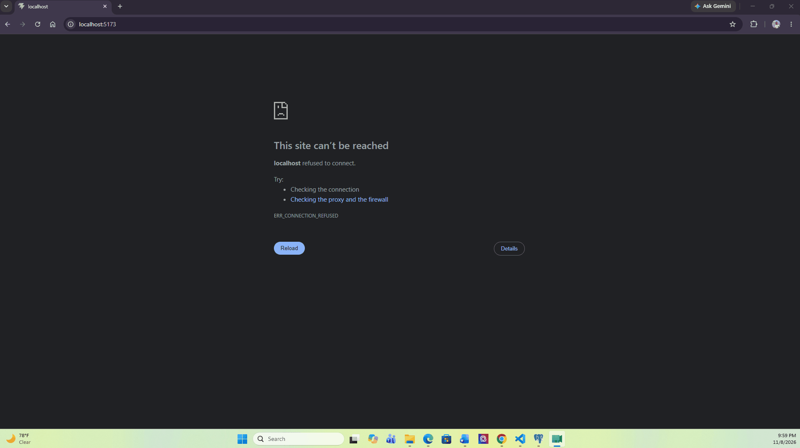
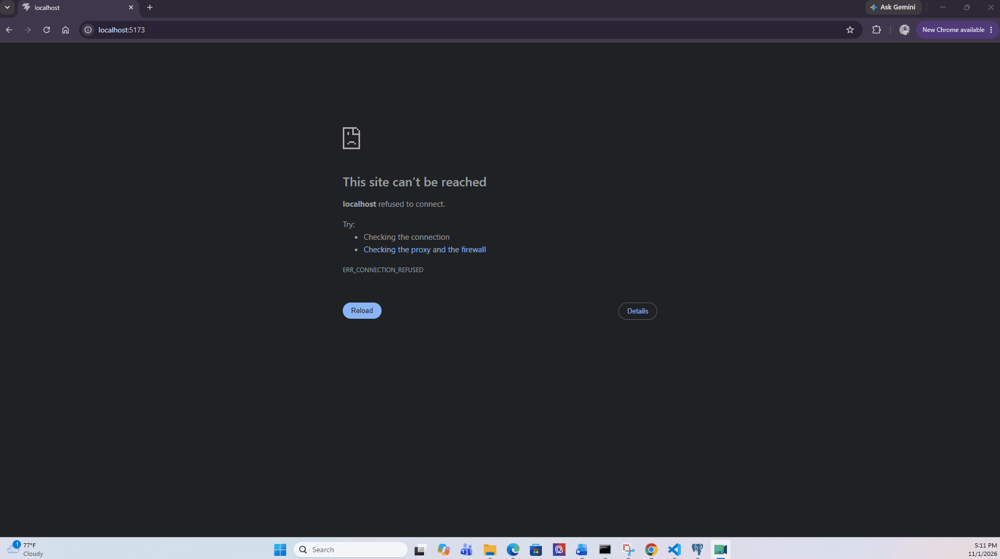

# Local Bloom

CodePath WEB103 Final Project

Designed and developed by: 
Jean Pierre Joseph, Paola Cuevas, Thy Tran

🔗 Link to deployed app: https://web103-finalproject-bkmi.onrender.com

## About

### Description and Purpose

Local Bloom is a community exploration platform designed to help creatives and locals discover independent art businesses, craft supply shops, cozy cafes, indie bookstores, or hands-on creative workshops. Many unique small businesses and local craft gatherings lack high-visibility marketing channels and get buried by large commercial chains on conventional map services. Local Bloom solves this by providing a curated directory where users can search, explore, and filter hidden gems by activity type, distance, and budget tier ($ to $$$). Users can view comprehensive details about each location or event, while business owners and event organizers can list their venues and post upcoming workshops.

### Inspiration

As makers and art enthusiasts, finding affordable materials and local creative workshops often requires digging through fragmented social media posts, scattered forums, or word-of-mouth recommendations. We wanted to build a centralized, community-driven hub that bridges the gap between independent artisans and local residents looking for creative outlets. By spotlighting small, independent businesses—from pottery studios and secondhand craft supply stores to indie bookstores hosting open mic nights—Local Bloom fosters local creative economies and makes hands-on arts accessible to everyone.

## Tech Stack

Frontend: React, React Router, HTML5, CSS3, JavaScript (ES6+)

Backend: Node.js, Express.js, PostgreSQL, Render

## Features

### ✅ Multi-Criteria Search & Filter

Users can dynamically filter local businesses and creative events by activity type, distance/radius, and budget tier ($ to $$$) without leaving the discovery dashboard.

*Milestone 4: filtering by activity type, budget tier, and tag. Milestone 5: added the distance/radius filter, which uses the browser's location. The redesigned header shows the price, activity type, and distance filters; filtering by tag still works through the API (`/api/events?tag=pottery`).*



https://imgur.com/a/v3j7l6c


### ✅ Interactive Detail View with Dynamic Routing

Each business and event features a dedicated dynamic detail page showcasing operating hours, full address, pricing tiers, and an overview of upcoming workshops or supplies offered.

[gif goes here]

### ✅ Community Spot Submission & Management

Business owners and event organizers have access to a dedicated management interface where they can register new events, edit existing details , and delete obsolete events or venue pages.

*Milestone 4: create, edit, and delete events. Milestone 5: organizers log in with GitHub, only an event's creator can edit or delete it, new venues can be added from the event form, and venue owners can delete unused venues at `/venues`. Separate venue detail pages were cut.*


https://imgur.com/a/9ys2AFN

### ✅ Categorization & Tagging via Join Table

Each event belongs to one activity type and can carry multiple descriptive tags (linked through a join table), making cross-discipline events easily discoverable.


https://imgur.com/a/DUk4xFQ


### Quick-View Slide-Out Modal

Users can click on any event card in the catalog to launch a slide-out modal pane containing an instant snapshot of the business, its tags, and quick-action links without navigating away from the discovery view.

[gif goes here]


https://imgur.com/a/uoApAau


### Owner Form & Input Data Validation

All submission and edit forms for organizers enforce strict client and server-side data validation before updating the database, requiring valid external URLs, structured address inputs, and standardized budget ranges.

### Disable Buttons After They Have Been Clicked

A button can't be clicked twice while its action is running. Every button that sends a request is disabled with a spinner until it finishes, so there are no double saves, deletes or logouts.

Button audit (all 22 `<button>` elements in `client/src`):

| Behavior after a click | Buttons | Count |
|---|---|---|
| **Disabled while its action runs** | Save/unsave, Reset demo data, Log out, Find coordinates, event form submit, venue form submit, Delete (event page, My Events, My Venues), Remove picture and ← Back (disabled while the form saves) | 11 |
| **Removed from the screen by the click**, so it can't be clicked again | Confirm modal Cancel / Delete, toast ✕, quick-view ✕, calendar day, Next → | 6 |
| **Open/close toggles**, which must stay clickable (still disabled while a form saves) | Dropdown trigger, date field, calendar ‹ / ›, avatar menu | 5 |

**17 of 22 buttons (77%)** can't be clicked twice. That's every button that performs an action. The 5 toggles are left enabled on purpose, because disabling them would stop you from closing what you just opened.

## Smoke Tests

Read-only checks that every page and public API route responds. They never log in or write data, so they are safe to run against the live site.

```bash
cd server
BASE_URL=https://<your-app>.onrender.com npm run smoke   # the deployed app
npm run smoke                                            # defaults to http://localhost:3001
```

The deployed app's first request may be slow while Render wakes the service. The client must be built (`npm run build` in `client/`) for the server to serve the pages.

## Installation Instructions

Requires [Node.js](https://nodejs.org/) 22 or newer and [PostgreSQL](https://www.postgresql.org/).

1. **Clone and install**

   ```bash
   git clone https://github.com/LOCALBLOOM-Web103/web103_finalproject.git
   cd web103_finalproject
   npm install --prefix server
   npm install --prefix client
   ```

2. **Create a database** named `localbloom`:

   ```bash
   createdb localbloom
   ```

   (or run `CREATE DATABASE localbloom;` in `psql`)

3. **Create a GitHub OAuth app** at GitHub → Settings → Developer settings → OAuth Apps → New OAuth App:
   - Homepage URL: `http://localhost:5173`
   - Redirect URI: `http://localhost:5173/auth/github/callback`

   Copy the Client ID, then generate and copy a client secret.

4. **Set up `server/.env`**: copy `server/.env.example` to `server/.env` and fill in:

   | Variable | Value |
   |---|---|
   | `DATABASE_URL` | `postgresql://postgres:<your-password>@localhost:5432/localbloom` |
   | `SESSION_SECRET` | output of `node -e "console.log(require('crypto').randomBytes(32).toString('hex'))"` |
   | `GITHUB_CLIENT_ID` / `GITHUB_CLIENT_SECRET` | from step 3 |
   | `GITHUB_CALLBACK_URL` | `http://localhost:5173/auth/github/callback` |

5. **Create the tables and load the sample data** (this deletes any existing Local Bloom data):

   ```bash
   cd server
   # macOS / Linux / Git Bash
   LOCALBLOOM_CONFIRM_RESET=DELETE_AND_RESEED_LOCALBLOOM npm run reset -- --execute-reset
   # Windows PowerShell
   $env:LOCALBLOOM_CONFIRM_RESET="DELETE_AND_RESEED_LOCALBLOOM"; npm run reset -- --execute-reset
   ```

6. **Run the app** in two terminals from the project root:

   ```bash
   npm run dev --prefix server   # API on http://localhost:3001
   npm run dev --prefix client   # app on http://localhost:5173
   ```

   Open http://localhost:5173 and log in with GitHub. Once logged in, the **Reset demo data** button in the header restores the sample data at any time.

### Deploying to Render

- Build command: `npm run build` · Start command: `npm start`
- Environment variables: the same as `server/.env`, plus `NODE_ENV=production`. Use the database's **Internal** URL for `DATABASE_URL` and `https://<your-app>.onrender.com/auth/github/callback` for `GITHUB_CALLBACK_URL` (add it as a second redirect URI on the GitHub OAuth app).
- Create the tables once from your computer by running step 5 with `DATABASE_URL` set to the database's **External** URL.
