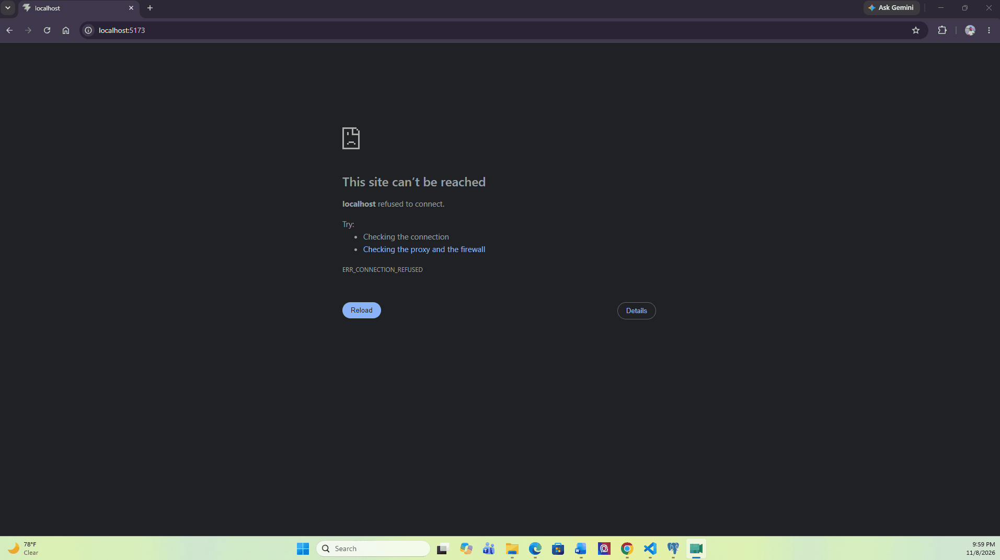
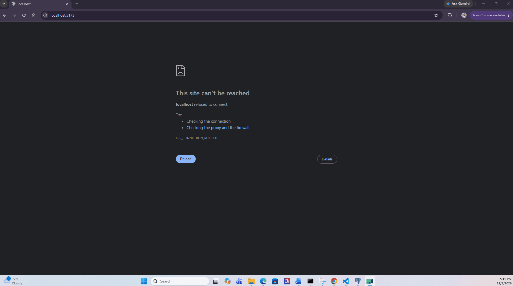

# Local Bloom

CodePath WEB103 Final Project

Designed and developed by: 
Jean Pierre Joseph, Paola Cuevas, Thy Tran

🔗 Link to deployed app:

## About

### Description and Purpose

Local Bloom is a community exploration platform designed to help creatives and locals discover independent art businesses, craft supply shops, cozy cafes, indie bookstores, or hands-on creative workshops. Many unique small businesses and local craft gatherings lack high-visibility marketing channels and get buried by large commercial chains on conventional map services. CraftSpot solves this by providing a curated directory where users can search, explore, and filter hidden gems by activity type, distance, and budget tier ($ to $$$). Users can view comprehensive details about each location or event, while business owners and event organizers can list their venues and post upcoming workshops.

### Inspiration

As makers and art enthusiasts, finding affordable materials and local creative workshops often requires digging through fragmented social media posts, scattered forums, or word-of-mouth recommendations. We wanted to build a centralized, community-driven hub that bridges the gap between independent artisans and local residents looking for creative outlets. By spotlighting small, independent businesses—from pottery studios and secondhand craft supply stores to indie bookstores hosting open mic nights—CraftSpot fosters local creative economies and makes hands-on arts accessible to everyone.

## Tech Stack

Frontend: React, React Router, HTML5, CSS3, JavaScript (ES6+)

Backend: Node.js, Express.js, PostgreSQL, Render

## Features

### ✅ Multi-Criteria Search & Filter

Users can dynamically filter local businesses and creative events by activity type, distance/radius, and budget tier ($ to $$$) without leaving the discovery dashboard.

*Completed in Milestone 4: filtering by activity type, budget tier, and tag. The distance/radius filter is planned for Milestone 5.*

https://imgur.com/a/v3j7l6c

### ✅ Interactive Detail View with Dynamic Routing

Each business and event features a dedicated dynamic detail page showcasing operating hours, full address, pricing tiers, and an overview of upcoming workshops or supplies offered.

[gif goes here]

### ✅ Community Spot Submission & Management

Business owners and event organizers have access to a dedicated management interface where they can register new events, edit existing details , and delete obsolete events or venue pages.

*Completed in Milestone 4: create, edit, and delete events. Venue pages are planned for a later milestone.*

https://imgur.com/a/9ys2AFN

### ✅ Categorization & Tagging via Join Table

Each event belongs to one activity type and can carry multiple descriptive tags (linked through a join table), making cross-discipline events easily discoverable.

https://imgur.com/a/DUk4xFQ

### Quick-View Slide-Out Modal

Users can click on any event card in the catalog to launch a slide-out modal pane containing an instant snapshot of the business, its tags, and quick-action links without navigating away from the discovery view.

[gif goes here]

https://imgur.com/a/uoApAau

### Owner Form & Input Data Validation

All submission and edit forms for organizers enforce strict client and server-side data validation before updating the database, requiring valid external URLs, structured address inputs, and standardized budget ranges.

## Installation Instructions

[instructions go here]
